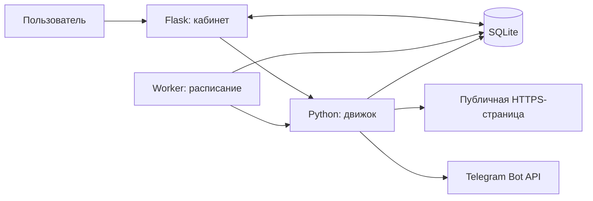

# RivalWatch 🔎

[](https://github.com/number16-gif/RivalWatch/actions/workflows/tests.yml)    

**Учебный Python-проект: мониторинг изменений веб-страниц с веб-интерфейсом и Telegram-уведомлениями.**

[English README](README.en.md) · [Как выложить проект на GitHub](GITHUB_UPLOAD.md)

> **Статус:** локальный прототип / pet project для портфолио. **Не** готовый коммерческий SaaS и **не** сервис для публичного размещения в интернете.

## О проекте

RivalWatch помогает узнавать, когда изменяется текст на публичной веб-странице. Пользователь добавляет HTTPS-ссылку, выбирает периодичность проверки, а приложение сохраняет предыдущую версию и сравнивает её с новой. История доступна в личном кабинете; при желании можно настроить уведомления через Telegram.

Пример: страница содержала «Цена: 1000 рублей», затем стала показывать «Цена: 900 рублей». RivalWatch сохраняет это как событие и показывает разницу.

### Возможности

- Регистрация и вход в **локальный** веб-кабинет (пароли хранятся в виде хешей).
- Добавление, отключение, удаление и ручная проверка страниц.
- Автоматические проверки через отдельный процесс `worker.py`.
- Сравнение текста, сохранение истории изменений и журналов попыток в SQLite.
- Необязательные уведомления в Telegram через Bot API.
- Встроенная **офлайн-демостраница** — для тестирования интернет не нужен.
- Базовые ограничения сетевых запросов: только HTTPS, проверки `robots.txt`, лимит размера ответа, запрет редиректов и внутренних IP-адресов на уровне предварительной проверки.
- Тесты на `unittest` и конфигурация GitHub Actions.

## Стек

`Python 3.11+` · `Flask` · `SQLite` · `requests` · `BeautifulSoup` · `HTML/CSS` · `Telegram Bot API` · `unittest`

## Как запустить на Windows 11

1. Установи [Python](https://www.python.org/downloads/) версии **3.11 или выше**.
2. Скачай этот репозиторий: **Code → Download ZIP**, распакуй архив.
3. Открой папку проекта и запусти `install.bat` — скрипт создаст `.venv` и установит библиотеки.
4. Запусти `start_web.bat` и открой **http://127.0.0.1:5000**.
5. Зарегистрируй локальный аккаунт и нажми **«Добавить демо»**.
6. Открой демостраницу в кабинете, нажми **«Проверить сейчас»** для сохранения исходной версии.
7. В созданном файле `demo.html` поменяй `1000` на `900`, сохрани файл и снова нажми **«Проверить сейчас»**. В истории появится изменение.
8. Для периодических проверок запусти `start_worker.bat` в **другом окне** терминала.

Приложение работает на `127.0.0.1` и не должно быть открыто наружу. При закрытии обоих окон автоматический мониторинг останавливается.

### Альтернативный запуск в PowerShell

```powershell
py -m venv .venv
.venv\Scripts\python.exe -m pip install -r requirements.txt
.venv\Scripts\python.exe app.py
```

В другом терминале:

```powershell
.venv\Scripts\python.exe worker.py
```

Для одной итерации фонового обработчика можно использовать `python worker.py --once` внутри активного окружения.

## Telegram (необязательно)

1. Создай бота через официальный [@BotFather](https://t.me/BotFather).
2. Скопируй `.env.example` в `.env` и заполни `TELEGRAM_BOT_TOKEN=...`. **Не добавляй `.env` в Git.**
3. Напиши своему боту `/start` и любое сообщение.
4. Выполни `.venv\Scripts\python.exe telegram_chat_id.py`, чтобы увидеть свой Chat ID.
5. В разделе «Настройки» веб-кабинета укажи Chat ID. После настройки токена перезапусти приложение и worker.

## Как устроен проект

```text
RivalWatch/
├── app.py                 # Flask: аккаунты, кабинет, действия с URL
├── engine.py              # Загрузка HTML, сравнение текста, Telegram
├── worker.py              # Проверки по расписанию
├── database.py            # SQLite и создание таблиц
├── settings.py            # Настройки, пути, переменные окружения
├── telegram_chat_id.py    # Получение Telegram Chat ID
├── templates/             # HTML-шаблоны интерфейса
├── static/style.css       # Оформление
├── tests/                 # Тесты движка и веб-маршрутов
├── .github/workflows/     # CI: запуск тестов при push и PR
├── requirements.txt
├── .env.example
└── README.md
```

**Поток данных:** веб-кабинет → SQLite → worker → запрос и разбор HTML → сравнение → запись в историю → (опционально) сообщение в Telegram.



## Тестирование

После установки зависимостей:

```powershell
.venv\Scripts\python.exe -m unittest discover -s tests -v
```

В GitHub Actions тесты запускаются автоматически на Python 3.11 и 3.12. Реальный результат CI будет виден во вкладке **Actions** после первой публикации.

## Ограничения и безопасность

- Это **pet project**, а не готовая платформа: Flask development server не предназначен для публичного доступа.
- Для публичного запуска требуется дополнительная защита от **SSRF / DNS rebinding** на сетевом уровне, изоляция worker, полноценные лимиты и аудит безопасности. Предварительная проверка URL **не гарантирует** защиту.
- Необходимо соблюдать `robots.txt`, правила и ограничения сайтов. Никаких обходов авторизации, CAPTCHA или запретов.
- Поддерживаются обычные доступные HTML/текстовые страницы; сайты с JavaScript-рендерингом и большинство маркетплейсов могут не работать.
- Изменения динамических блоков способны создавать ложные оповещения; выделение конкретной области страницы пока не поддерживается.
- Публичного API, платёжной системы, отдельных коммерческих тарифов и готовых интеграций с Ozon/Wildberries **нет**.
- Токены (`.env`), БД, логи и секреты Flask исключены из Git через `.gitignore`. Если секрет случайно попал в историю Git, одного удаления файла недостаточно — токен надо перевыпустить.

## Что можно улучшить

- [ ] Выбор HTML-элемента / CSS-селектора для мониторинга.
- [ ] Подавление незначительных изменений и шумных блоков.
- [ ] Более надёжная очередь фоновых проверок и сетевые ограничения.
- [ ] Тесты с фиксированными HTML-файлами и проверка реального интерфейса в браузере.
- [ ] Разрешённые API-интеграции с магазинами и маркетплейсами.
- [ ] Отдельное развертывание на сервере после доработки безопасности.

---

**Почему проект интересен для портфолио:** сочетает веб-разработку на Flask, работу с HTML, фоновые задачи, SQLite, авторизацию, интеграцию с Telegram и автоматические тесты.

**Лицензия:** не выбрана. Если решишь разрешить другим использовать или изменять код, добавь подходящую лицензию в репозитории.
